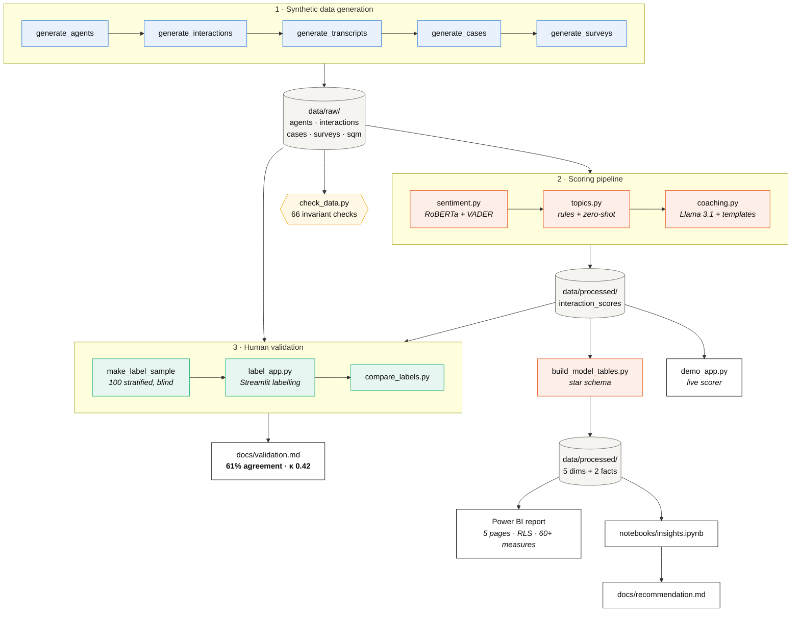

# utility-cx-insights

**An end-to-end customer-experience analytics pipeline for a utility contact centre** —
synthetic data generation, NLP sentiment scoring, human validation, a dimensional
model, a Power BI report specification, and the change-management case to act on it.

> ### ⚠️ All data in this project is synthetic
> There is no real utility, no real customers, no real agents and no real
> conversations. Every name, account number, transcript and metric is generated.
> The fictional operator is **Prairie Sky Utilities**. Agent emails use
> `.example.com`, a domain [RFC 2606](https://www.rfc-editor.org/rfc/rfc2606)
> reserves so it can never resolve or receive mail.

---

## The business problem

A utility contact centre handles tens of thousands of contacts a month — high bill
disputes, outages, move-ins, payment arrangements. It knows two things about them:
**how long they took**, and **what the 15% of customers who answer a survey said**.

That leaves the expensive question unanswered: *was the customer actually dealt with?*

- Survey CSAT is not a measurement of customers, it is a measurement of the
  customers who fill in surveys — and unhappy ones do so far more often.
- Handle time measures cost, not outcome. A fast contact that resolves nothing is
  the most expensive kind.
- The transcripts contain the answer, and nobody reads them. There are too many.

**This project reads them.** It scores every contact for sentiment, classifies it,
writes a coaching note, validates the model against human judgement, and turns the
result into something a contact centre manager can act on.

The headline it surfaces: **contacts that *end* badly are 3× more likely to bring
the customer back within a week** — 41.9% against 13.5%. Not contacts that start
badly. Contacts that end badly. That is a fixable, thirty-second problem, and no
existing metric was showing it.

---

## What this demonstrates

Mapped to what a **Technology Analyst in a utility contact centre** is actually
asked to do:

| Capability | Where to look |
|---|---|
| **Understand the operational domain** | Gigajoules, estimated vs actual meter reads, catch-up bills, the Alberta winter disconnection window (Oct 15 – Apr 15), equalized payment plans, regulated rate vs fixed term, outage tickets. Baked into [`src/generate_transcripts.py`](src/generate_transcripts.py). |
| **Build and defend a data pipeline** | Seven generators and scorers, idempotent and seeded, orchestrated by [`src/generate_all.py`](src/generate_all.py) and [`src/run_pipeline.py`](src/run_pipeline.py). Byte-identical on re-run. |
| **Apply NLP without overselling it** | VADER baseline vs a CPU transformer, then **validated against 100 hand-read transcripts** — and the honest finding that the model is systematically wrong in one direction. [`docs/validation.md`](docs/validation.md) |
| **Design a dimensional model** | Star schema with conformed dimensions, surrogate keys, role-playing date relationships, and a documented refusal to store pre-computed ratios. [`powerbi/model_relationships.md`](powerbi/model_relationships.md) |
| **Specify a BI deliverable** | 60+ DAX measures, Power Query M, an accessible theme, RLS roles, and a page-by-page build guide. [`powerbi/`](powerbi/) — and the same five pages built in Streamlit so the report is viewable without a licence. |
| **Test data, not just code** | 152 tests covering generation invariants, referential integrity, model contracts, and the coaching tone guarantee. |
| **Handle people data responsibly** | Row-level security, a `.example.com` domain, payment details redacted in every transcript, and an agent-facing guide that states the scores are never used for discipline. [`docs/ccr_quick_reference.md`](docs/ccr_quick_reference.md) |
| **Turn analysis into a decision** | A one-page recommendation with evidence, expected impact, measurement plan and a change-management rollout. [`docs/recommendation.md`](docs/recommendation.md) |
| **Communicate to non-technical readers** | Three documents written for managers and agents rather than analysts, in their language. |

---

## Architecture



---

## Setup

Python 3.11+. Everything runs on a laptop CPU — no GPU, no cloud, no database.

```bash
git clone git@github.com:bdakhel/utility-cx-insights.git
cd utility-cx-insights

python3 -m venv .venv
source .venv/bin/activate          # Windows: .venv\Scripts\activate
pip install -r requirements.txt
```

The first sentiment run downloads ~500 MB of model weights from Hugging Face and
caches them. Coaching notes use a local [Ollama](https://ollama.com) server if one
is running; without it they fall back to a template engine and nothing breaks:

```bash
ollama pull llama3.1:8b            # optional
```

## Run it

```bash
# 1 · Generate the synthetic dataset           (~2 s)
python src/generate_all.py

# 2 · Verify it                                (~1 s, 66 checks)
python src/check_data.py

# 3 · Score every contact                      (~70 s with Ollama off)
python src/run_pipeline.py

# 4 · Build the Power BI star schema           (~3 s)
python src/build_model_tables.py
python src/export_powerbi_workbook.py

# 5 · Tests
python -m pytest tests/ -q
```

Then explore:

```bash
streamlit run src/demo_app.py          # the full report + a live transcript scorer
streamlit run src/label_app.py         # blind human labelling tool
jupyter notebook notebooks/            # validation + insights analysis
```

<details>
<summary><b>Optional: the individual scorers and the validation loop</b></summary>

`run_pipeline.py` writes one joined `interaction_scores.csv`. If you want the
per-model artefacts in `data/labels/` — which `compare_labels.py` reads — run the
scorers standalone too:

```bash
python src/sentiment.py --scorer both      # writes sentiment_vader / sentiment_roberta
python src/topics.py --classifier rules    # writes topics_rules
python src/coaching.py                     # writes coaching_notes

python src/make_label_sample.py            # 100 blind transcripts to label
streamlit run src/label_app.py             # label them
python src/ai_label.py                     # optional LLM second opinion
python src/compare_labels.py               # all label sources side by side
```
</details>

---

## Folder structure

```
utility-cx-insights/
├── src/
│   ├── generate_agents.py          20 CCRs, 4 teams, tenure spread
│   ├── generate_interactions.py    2,000 contacts with planted patterns
│   ├── generate_transcripts.py     phrase-bank dialogue, payment data redacted
│   ├── generate_cases.py           1,823 cases, real repeat-contact chains
│   ├── generate_surveys.py         CSAT responses + monthly FCR scorecard
│   ├── generate_all.py             runs the five in order, as subprocesses
│   ├── check_data.py               66 invariant checks → docs/data_check.md
│   │
│   ├── sentiment.py                VADER + RoBERTa, sentence-boundary chunking
│   ├── topics.py                   keyword rules (99.5%) + zero-shot option
│   ├── coaching.py                 Llama 3.1 + templates, with a tone filter
│   ├── run_pipeline.py             all three stages → interaction_scores.csv
│   │
│   ├── make_label_sample.py        100 blind transcripts, stratified
│   ├── label_app.py                Streamlit labelling tool
│   ├── ai_label.py                 LLM judge — a second opinion, not truth
│   ├── compare_labels.py           human vs AI vs model vs generator
│   │
│   ├── build_model_tables.py       star schema
│   ├── export_powerbi_workbook.py  one .xlsx for the Power BI service
│   ├── measures.py                 the DAX measure library, in pandas
│   └── demo_app.py                 the report (5 pages) + live scorer
│
├── notebooks/
│   ├── validation.ipynb            how accurate is the model, really?
│   └── insights.ipynb              what drives bad contacts
│
├── powerbi/
│   ├── BUILD_GUIDE.md              step-by-step, browser-based (Mac-friendly)
│   ├── model_relationships.md      every table, every relationship
│   ├── measures.dax                60+ measures in display folders
│   ├── load_queries.m              Power Query M with explicit types
│   ├── theme.json                  accessible, CVD-validated palette
│   └── rls_roles.md                CCR and Team Lead security
│
├── docs/
│   ├── data_dictionary.md          every one of 192 fields + every KPI formula
│   ├── validation.md               plain-English accuracy write-up
│   ├── recommendation.md           the business case
│   ├── ccr_quick_reference.md      agent-facing guide
│   └── data_check.md               generated QA report
│
├── tests/                          152 tests
└── data/                           all generated, all gitignored
```

---

## Validation results

The part most portfolio projects skip. **100 transcripts were read by a person in a
blind app** — no model output, no generator label, not even the topic, so the human
judgement is genuinely independent.

| Scorer | Agreement with human | Cohen's κ |
|---|---|---|
| VADER (lexicon baseline) | 47% | 0.19 — barely above chance |
| **RoBERTa** | **61%** | **0.42 — moderate** |
| *Generator's own label* | *88%* | *0.82 — the realistic ceiling* |

**The finding that mattered:** RoBERTa made 39 errors and **all 39 judged the
customer unhappier than the human did.** Not one went the other way. Errors
scattered in both directions are noise; errors all pointing one way are a
miscalibrated threshold — fixable without retraining.

Scoring the **end** of the conversation rather than its average lifts held-out
agreement from **56% to 77%**, five-fold cross-validated. That single change is now
the recommended default throughout the model and the report.

Other measured results:

- **Topic classification: 99.5%** on all 2,000 (keyword rules beating a transformer,
  with the caveat that the rules were written knowing the phrase banks)
- **Coaching notes: 1,791 of 2,000** written by Llama 3.1; the rest fell back to
  templates, with a safety filter catching disciplinary language in real model output
- **Data integrity: 66/66** checks pass; every generator is byte-identical on re-run

---

## Screenshots

> *Placeholders — see the manual checklist at the end.*

| | |
|---|---|
| **Executive Scorecard** | `` |
| **Sentiment & Topics** | `` |
| **Team & Coaching** | `` |
| **CCR Self-View** | `` |
| **Interaction Detail** | `` |
| **Live demo app** | `` |
| **Streamlit report** | `` |
| **Validation charts** | `` |

---

## Limitations

Stated plainly, because a portfolio project that hides these is less useful than one
that names them.

**The data is synthetic.** Patterns were planted and then recovered. That validates
the *method*, not the findings. Real transcripts are messier, real sentiment is
harder, and every accuracy figure here should be expected to drop on live data.

**The topic classifier has seen the answer.** Its keyword weights were written by
reading the generator's phrase banks. 99.5% is an upper bound, not a forecast. The
zero-shot comparison that would have given a realistic cold-start number could not
be run — the `bart-large-mnli` download stalls on this machine.

**One labeller, 100 transcripts.** Enough to see a clear directional pattern, not
enough for precision — and with a single labeller there is no inter-rater baseline,
which is the real benchmark for "good enough".

**Survey CSAT is biased low** by a 15% response rate skewed toward unhappy customers.

**FCR cannot be re-aggregated.** The source supplies a finished percentage with no
counts behind it, so any roll-up is an unweighted mean. Flagged everywhere it appears.

**The sentiment model is not fit for performance management**, and the project says
so in the documents agents will read. 61% accuracy with a systematic pessimistic
bias belongs nowhere near an employment decision.

**Known data quirks:** handle time excludes hold (they are drawn independently, so
hold exceeds handle on 56 contacts); 71 contacts fall on an Alberta statutory holiday
because the generator uses business days without skipping them. Both are documented
and filterable rather than quietly patched.

---

## Next steps

**1 · Speech-to-text for voice contacts.**
Two-thirds of contacts are voice, and this project scores a *transcript* that a real centre
would have to produce. The realistic path is a local Whisper model (`faster-whisper`,
CPU-viable) over call recordings, with diarisation to split agent from customer —
which matters here, because the sentiment scorer deliberately reads only the
customer's turns. Expect accuracy to fall: ASR errors, crosstalk and Alberta place
names will all degrade the input before the model sees it. The honest first step is
measuring how much.

**2 · Real-time in-call feedback.**
The validated finding is that *how a contact ends* predicts whether the customer
comes back. That is only actionable while the contact is still open. A streaming
version would score the rolling last-N turns and surface a quiet prompt to the agent
— *"sentiment is dropping; try a recap"* — before the close rather than after.

This is the highest-value and highest-risk extension. Live scoring of an agent's
conversation is surveillance unless it is designed otherwise: the prompt must go to
the agent and nobody else, it must not be logged against them, and agents should be
able to turn it off. Build it with the floor, not for them.

**3 · Privacy impact assessment under Alberta's PIPA.**
Before any of this touches real data it needs a privacy review under Alberta's
*Personal Information Protection Act*.

To be accurate about the obligation: **a PIA is not mandatory for private-sector
organizations under PIPA** — the
[Office of the Information and Privacy Commissioner](https://oipc.ab.ca/?p=3360)
recommends them as best practice. Mandatory PIAs apply under the *Health Information
Act*, which does not cover a utility. PIPA does, however, govern this data, including
**personal employee information**, and carries a breach-notification duty where a
reasonable person would see a real risk of significant harm.

What a PIA should cover here:

- **Dual subjects.** Transcripts contain customer personal information *and*
  constitute employee performance data. PIPA treats "personal employee information"
  distinctly, and notice to agents is a live obligation, not a courtesy.
- **Consent and notification** for recording, transcribing and automated analysis —
  for customers at the point of contact, and for agents as a condition of the tool.
- **Purpose limitation.** Collected for coaching and service improvement. Written
  down, so it cannot quietly drift into performance management later.
- **Retention.** Transcripts are the most sensitive artefact and the least needed
  long-term. Scores and coaching notes can outlive the text they came from.
- **Automated decision-making.** The current design keeps a human between the model
  and any conclusion about an agent. That boundary should be a documented control,
  not a convention.
- **Data residency**, if any component is cloud-hosted.

The agent-facing commitments in
[`docs/ccr_quick_reference.md`](docs/ccr_quick_reference.md) — scores never used for
discipline, a no-questions dispute route — are the sort of thing a PIA should
formalise rather than leave to a README.

**Also worth doing:** re-run the zero-shot topic comparison on a machine where the
model downloads, extend the labelled set past 100 with a second labeller for an
inter-rater baseline, and fit the end-of-call decision threshold properly now that
the labels exist.

---

## Documentation

| Document | Written for |
|---|---|
| [`docs/validation.md`](docs/validation.md) | A manager deciding whether to trust the model |
| [`docs/recommendation.md`](docs/recommendation.md) | A contact centre manager deciding what to change |
| [`docs/ccr_quick_reference.md`](docs/ccr_quick_reference.md) | The agents being scored |
| [`docs/data_dictionary.md`](docs/data_dictionary.md) | Analysts and report builders |
| [`powerbi/BUILD_GUIDE.md`](powerbi/BUILD_GUIDE.md) | Whoever builds the report |
| [`CLAUDE.md`](CLAUDE.md) | Contributors — the project's non-negotiable rules |

---

*Built as a portfolio project. All data synthetic. No real utility, customers or
agents are represented.*
